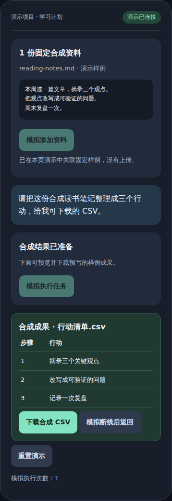

# 我不会写代码，但我把自己的 AI 工作台做出来了。

### Codex Mobile Workbench

**电脑负责执行，手机负责指挥。**

有想法，掏出手机派任务。做到一半，随时补充要求、调整方向。做出成果，直接在手机上查看、下载。

我不想每次让 AI 干点事，都得先坐回电脑前。于是，我和 AI 一起，把自己的 Codex 变成了一个能随身操作的工作台。

**不是再造一个聊天框，而是把自己的电脑，变成手机背后的执行端。**

[下载 Windows／WSL 技术预览](https://github.com/ai-agent-workbench/codex-mobile-workbench/releases) · [开始使用](docs/QUICKSTART.md) · [看看工作流](docs/DEMO.md) · [MIT](LICENSE)

## 离开桌面，事情照样可以往前推进

### 想到了，就让它开工

一个代码改动、一份需要整理的资料、一个待完成的小项目。打开手机，把任务交给自己电脑上的 Codex，不必等到回到桌前才记起这件事。

### 做到一半，继续指挥

查看任务进展，围绕同一个项目追问、补充资料、调整要求，处理需要你拍板的原生交互。不是每次打开手机，都重新解释一遍上下文。

### 不只得到回答，还能拿到成果

任务生成的文件有自己的查看和下载入口。把处理好的文档、代码或其他文件带走，而不只是截下一段聊天记录。

<p align="center">
  
  <br><sub>可交互合成演示的截图，非实机录屏；只使用公开样例，不连接模型或私人资料。</sub>
</p>

想亲手点一遍？完整下载源码或安装包后，在浏览器打开 [`docs/demo.html`](docs/demo.html)：添加样例 → 模拟任务 → 下载 CSV → 模拟返回原任务。[演示说明](docs/DEMO.md)

## 它是怎么来的

这个项目的起点，不是“我要做一款 AI 产品”，而是“我能不能让 AI 真正替我做事”。

我不写代码，负责提出目标、做选择、验收结果；AI 负责把需求变成实现。项目从自己电脑上的日常工作台一路演进，今天把原生 Codex 的任务、项目和文件成果接到了手机上。

这次开源的，是一条已经完成独立实例安装、手机绑定、真实任务和文件下载核心验证的路径。接下来，希望让更多有相同需求的人，能在自己的电脑上把它跑起来。

**代码不是终点。让自己的想法，变成真正能用的工具，才是。**

## 它连接的是你自己的 Codex

```text
你的手机／PWA
  ↓ 自己的 HTTPS 入口
你电脑上的独立工作台实例
  ↓ Conversation Service / Runtime
属主专用 Unix socket
  ↓
原生 Codex App Server → 项目、任务与文件成果
```

- **自己的电脑、账号和项目**：模型调用由自己的 Codex 账号与配置承担，不提供共享账号或公共模型额度。
- **原生执行，不另造一套裁判**：手机认证、原生权限／审批与操作系统权限各自负责，不沿用旧工作台的 Windows PIN 作为第二层执行门槛。
- **独立安装与维护**：Windows 薄面板编排 WSL 实例的检查、安装、启停、备份和新目录恢复，不接管作者的生产环境。
- **可选能力按需开启**：持久化定时任务与自己配置的完成通知，新安装默认关闭。

## 从这里开始

1. 准备 **Windows＋Ubuntu 24.04 WSL2、x86-64、Python 3.12**，以及手机可达的可信 HTTPS。
2. 到 [Releases](https://github.com/ai-agent-workbench/codex-mobile-workbench/releases) 下载**完整 Windows／WSL 附件包**，核对 SHA-256。GitHub 自动生成的 Source code ZIP 不包含面板 EXE 和安装清单。
3. 按 [快速开始](docs/QUICKSTART.md) 创建独立实例、本人登录、绑定手机，再完成自己的第一个任务。

电脑需要保持运行，手机需要能连接该实例；保存一个 HTTPS 地址不会自动配置网络。安装会联网取得固定上游依赖，Windows 面板不自动安装 WSL，不是从零一键部署器。

## 现在到哪一步了

这是首个 **Windows／WSL 技术预览**，固定 Codex 0.160.0 完整原生运行包。

已发布的是 **Windows 面板＋WSL 后端**，不是 Windows 原生后端。当初选择 WSL，是为了减少 Windows 命令引号、转义及路径兼容问题造成的返工；这是当时的工程取舍，不是 Windows 不能运行 Codex。Windows 原生后端正在单独验证，尚未作为本项目的可安装版本提供，见 [支持矩阵](docs/SUPPORT_MATRIX.md)。

下一版安装修复候选提供“沿用现有 WSL 配置／明确直连／指定代理”，不再一律要求代理；已发布附件的行为仍以其固定版本为准。[网络选择与首次使用](docs/QUICKSTART.md) · [手机接入路线](docs/PHONE_ACCESS.md)。

维护者已经验证独立实例的原生登录、可信 HTTPS、实体手机 Passkey 绑定、真实模型任务、文件下载内容，以及本次维护重启后继续原对话。另一台电脑、原生 Linux、完整切后台／断网场景和旧公开版数据导入，尚未完成本次实机验收。详见 [支持矩阵](docs/SUPPORT_MATRIX.md)。

这是个人高权限工具：当前新对话默认 **Full Access**，原生任务可使用运行账户的系统权限。只连接自己的账号和设备；不要把它当作多人公共 AI 服务。[安全边界与私密漏洞报告](SECURITY.md) · [数据与费用](docs/PRIVACY_AND_COSTS.md)

## 和旧项目是什么关系

早期的 [AI Agent Workbench](https://github.com/ai-agent-workbench/ai-agent-workbench) 保留历史代码与文档。本项目是原生 Codex 执行链上的新一代独立项目，不是旧 CLI／Kimi 版本的覆盖升级包；首次使用应新建实例。[差异与兼容边界](docs/LEGACY_COMPATIBILITY.md)

## 深入了解与参与

- [版本说明](docs/RELEASE_NOTES.md) · [日常维护与恢复](docs/OPERATIONS.md) · [排障](docs/TROUBLESHOOTING.md)
- [Windows 面板构建](desktop/README.md) · [测试](tests/README.md)
- [反馈与贡献](CONTRIBUTING.md) · [发行核对](docs/RELEASE_CHECKLIST.md)
- 自有部分采用 [MIT](LICENSE)，保留原公开署名。上游 Codex、协议材料与依赖保持各自许可，见 [第三方声明](THIRD_PARTY_NOTICES.md)。

欢迎带着具体场景和脱敏复现来交流。项目不承诺持续维护或响应时限；请保留自己的资料备份。本项目不是 OpenAI 官方产品，不提供模型、账号、服务器或使用额度。

**English:** A self-hosted mobile workbench for your own Codex App Server. Start tasks, follow up, handle native interactions, and retrieve file artifacts from your phone while your own Windows/WSL computer does the work. Early technical preview; use your own account and trusted HTTPS. Unofficial, MIT-licensed, with upstream notices preserved.
